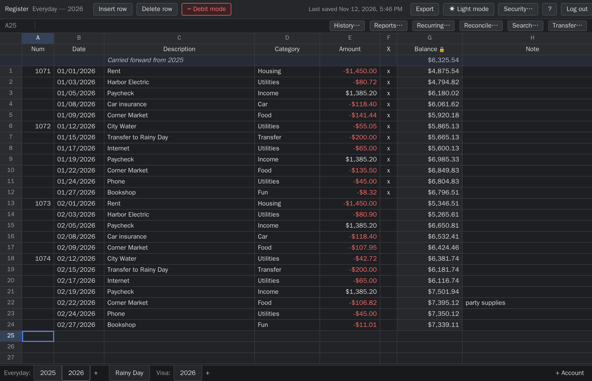
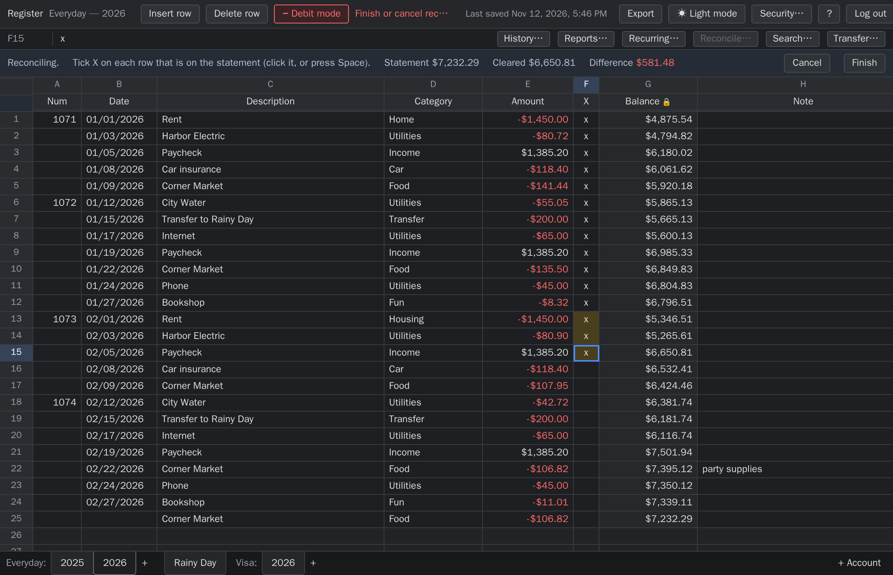
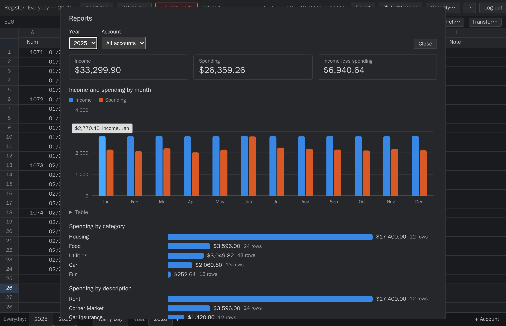
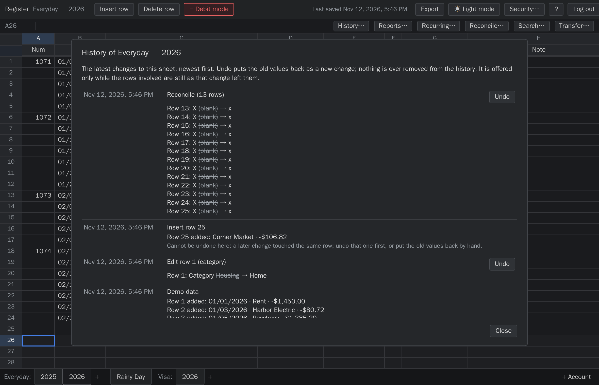
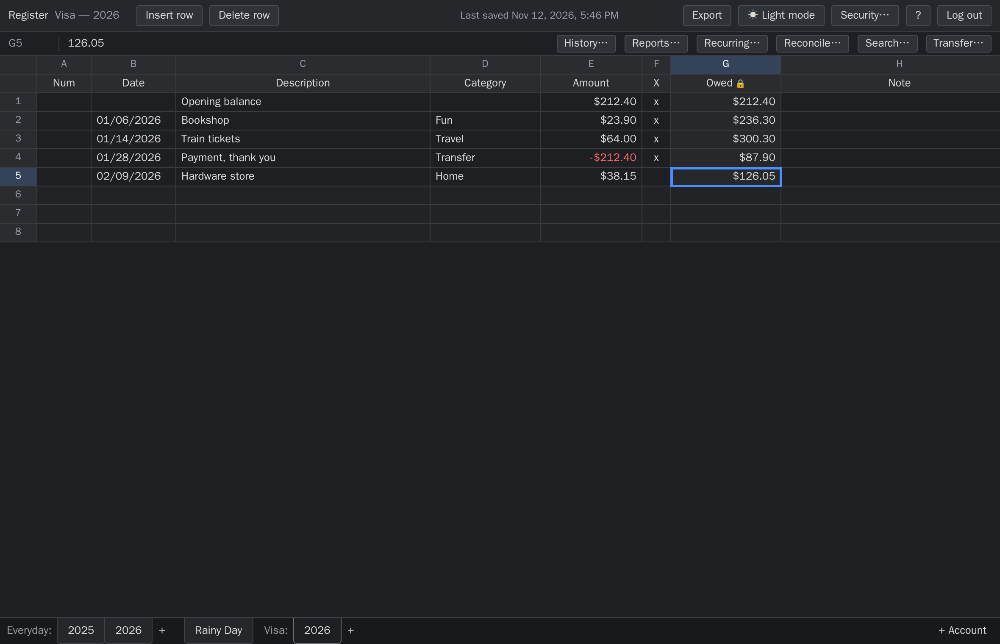
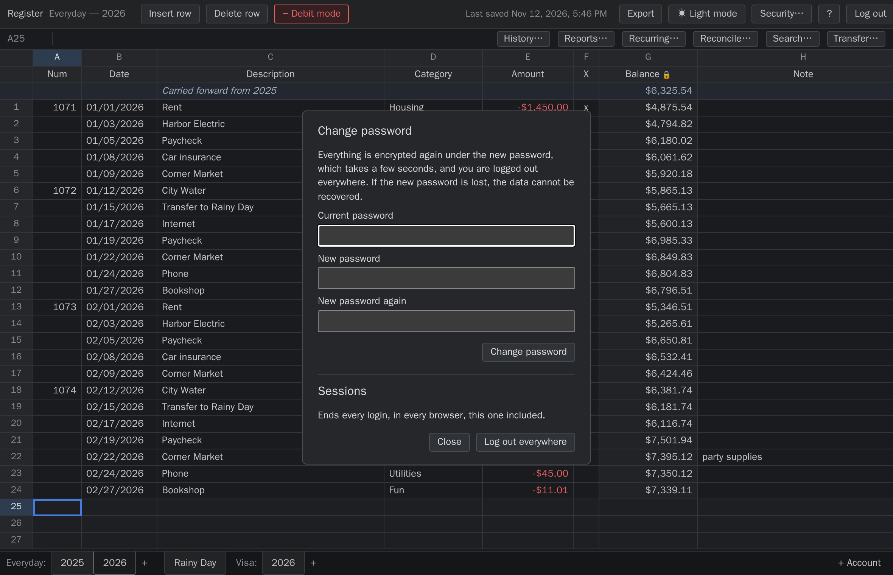
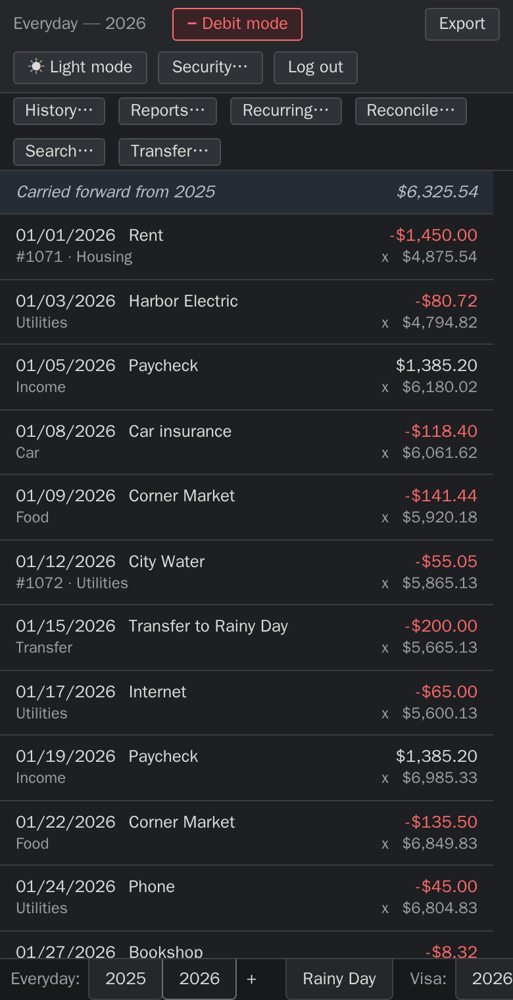

# account-register

A self-hosted check register that looks and works like the spreadsheet it replaces. It runs
in the browser, keeps every change in git, and encrypts everything on disk.

> **For one person, on a network you control** (your own machine, a LAN, or behind a VPN).
> **Do not put it on the open internet.** [SECURITY.md](SECURITY.md) says what the design
> protects and what it doesn't.

**[Try the demo](https://accountregister.gaijin.systems/)**: the real page running in your
browser tab with made-up data. Nothing is sent or stored, and reloading starts it over. It has
no server, so it shows the interface, not the encryption or the login.



## What it does

- **A grid with sheet tabs,** driven from the keyboard: checking and credit card accounts get
  one tab per year; savings, cash and loan accounts get a single tab.
- **A running balance that is always right.** It is computed, never stored, and can't be
  edited.
- **Bookkeeping:** categories, transfers between accounts, autocomplete from earlier entries,
  search across years, reconciliation against a statement, recurring transactions, and
  yearly reports.
- **Every change is one git commit,** made by a separate *recorder* process. The web process
  can only send it a fixed set of operations. Each sheet has a history, with undo.
- **Encrypted at rest.** Every row is encrypted with a key derived from your password, so the
  data, its history and any backup are unreadable without it. Logging in unlocks it.
- **Imports** from LibreOffice, Excel and Google Sheets files, CSV, and bank downloads
  (OFX, QFX, QIF), each with a preview before anything is written. **Exports** to CSV, JSON,
  QIF and OFX.
- **One file to install:** `register.pyz`. It needs Python 3, `git` and Python's
  `cryptography` package; everything else is the standard library. No database, no build step.
- **Works on a phone** as a list of rows with an edit form.

| | |
|---|---|
|  |  |
|  |  |

All pictures show made-up data.

## Contents

- [Requirements](#requirements)
- [Build](#build)
- [Set up](#set-up)
- [Import](#import)
- [Export](#export)
- [Run](#run) and [HTTPS](#https)
- [Using it](#using-it)
- [Data and git](#data-and-git)
- [Backups](#backups)
- [License](#license)
- [Layout](#layout)

Also: [SECURITY.md](SECURITY.md), [docs/DESIGN.md](docs/DESIGN.md) (how it is put together
and why), [CONTRIBUTING.md](CONTRIBUTING.md), [CHANGELOG.md](CHANGELOG.md).

## Requirements

- **Linux.** It uses Unix sockets, peer credentials and `flock`. Other Unix systems are
  untested; Windows doesn't work.
- **Python 3.9 or later** (tested on 3.9 to 3.13), `git`, and Python's `cryptography` package (Debian/Ubuntu:
  `apt install python3-cryptography`; often already installed).
- **A reverse proxy for HTTPS** if you reach it from another machine; see [HTTPS](#https).

## Build

```
python3 build.py              # -> dist/register.pyz
python3 -m unittest discover -s tests
```

The tests need the `cryptography` package too. The recorder tests also need permission to create
Unix sockets; without it they are skipped. [CONTRIBUTING.md](CONTRIBUTING.md) shows how to run
them in a container, and how to try the app with made-up data.

Run `register.pyz` with no arguments (or `--help`) for the list of commands and a step-by-step
getting-started guide. Every command has its own `--help`.

## Set up

```
./register.pyz init --home ~/register          # asks for the password; creates config.json, run/, data/
```

**The password is the only key to the data.** If it's lost, the data can't be recovered; there
is no reset or recovery code. To change it:

```
./register.pyz change-password --home ~/register   # re-encrypts all current data in one commit
```

- **Old commits stay as they are.** History keeps the encryption that was current when each
  commit was made, so an old password still opens the commits from its own period, and nothing
  newer.
- **A running app locks itself** and asks for the new password at the next login.
- **From the web page:** **Security…** in the toolbar does the same (see "Using it").
- **A changed password doesn't protect old copies.** A backup or clone made before the change
  still opens with the old password.

`~/register/config.json` (mode 0600) holds:

| Key | Default | Meaning |
|---|---|---|
| `bind`, `port` | `127.0.0.1`, `8000` | where the web process listens |
| `cookie_secure` | `true` | the login cookie is sent over HTTPS only; see "HTTPS" below before changing it |
| `public_origin` | `null` | e.g. `"https://register.lan"`. Set this if the reverse proxy rewrites the `Host` header. Writes and logins must come from this origin. |
| `session_idle_minutes`, `session_max_hours` | `30`, `12` | login session limits |
| `auto_lock_minutes` | `30` | the recorder forgets the key after this long without activity |

`config.json` holds no secrets. The password isn't stored anywhere; logging in proves it by
decrypting the data.

## Import

`import` reads a spreadsheet or CSV file and works out the layout itself:

```
./register.pyz import --home ~/register workbook.ods
```

It takes LibreOffice/OpenOffice `.ods`, Excel `.xlsx` (and `.xlsm`) and CSV files. For
Google Sheets, download the sheet as `.xlsx`, `.ods` or CSV (File > Download) and import that.
The type is detected from the file's content, not its name. Files it cannot read get a
message saying what they are and what to do: old `.xls` and `.xlsb` workbooks,
password-protected workbooks, PDFs, Apple Numbers files, and the HTML pages some banks
hand out as "Excel" downloads. Re-save or re-download those as `.xlsx`, `.ods` or CSV.

What happens:
1. **How the file was read.** Which sheets it found, and for each one: where the data starts,
   the opening balance, which column is which, the date format and the decimal mark. Anything
   marked GUESSED or AMBIGUOUS needs a look.
2. **A preview.** For each sheet: the target account (new or existing, and whether it
   replaces a sheet), the number of rows, the closing balance against the file's own last
   balance, any warnings, and the first and last rows as they'll be stored.
3. **A question.** Nothing is written until you answer `y`. Without a terminal (in a script),
   add `--yes`. `--dry-run` shows the preview and stops.
4. **One commit** with everything, or nothing at all if any sheet has an error. If the data or
   the file changed between the preview and your answer, nothing is written and you're asked
   to run it again.

`import` asks for the password, like every command that reads or writes data. It uses
`REGISTER_PASSWORD` instead if that's set.

### Bank downloads, and adding to an account

A spreadsheet import fills whole sheets. To add a bank's latest transactions to an account
you already keep, import its download instead:

```
./register.pyz import --home ~/register january.qfx --account everyday
./register.pyz import --home ~/register statement.csv --account everyday --append
```

- **OFX, QFX and QIF files** are recognized by their content and always work this way. A
  CSV or spreadsheet does with `--append` (and then needs no balance column, only a header
  naming the date and amount columns).
- **The rows go to the end** of the account, oldest first, each in the tab of its year. You
  get the same preview and question, and one commit.
- **Year tabs:** a row goes into an existing year, or into the year after the last one, whose
  tab is then added; a file that runs on into further years adds those too, one after
  another. Rows dated before the account's first year, or that would leave a year out, stop
  the import: an account's years stay in one unbroken run that starts with its opening
  balance. Add the missing years first (`+` after the year tabs). Transfers and recurring
  transactions follow the same rule.
- **Rows already there are skipped,** so importing overlapping downloads is safe:
  - A row with the bank's transaction id (OFX, QFX) is skipped if a row with that id, date
    and amount is already in the account. The id is stored with the row; the grid doesn't
    show it. Some banks use an id again for a different transaction: that one is added, and
    the preview carries a WARNING saying how many such rows there are. The same happens if
    you (or the bank) changed the date or amount of a transaction after it was imported: the
    next overlapping file adds it again, with that WARNING.
  - If no row has that id, date and amount, but a row *you typed* has the same date and amount, that row is taken to
    be the same transaction: it is kept as you wrote it and the bank's id is recorded on it.
    The preview says how many rows matched this way.
  - A row without an id (QIF, CSV) is skipped if a row with the same date, amount and
    description is already there.
- **Which account:** `--account ID`; with only one account it can be left out, and with several
  it must be given. An id that
  doesn't exist yet makes a new account (`--name`, `--type`; the type otherwise comes from the
  file). A new account starts with an opening balance of 0.00 for you to correct.
- **A file with several accounts** is refused with their names; pick one with `--sheet` (the
  last four digits of the account number for OFX, the account name for QIF).
- **QIF dates** such as `1/5/2025` can be month/day or day/month. The preview says when both
  fit; `--date-format DD/MM/YYYY` chooses.
- **Amounts** are taken as the bank writes them: money out is negative, on a credit card too.
  An amount with more than two decimals stops the import; nothing is rounded.
- **A file that doesn't match the account** (a credit card statement into a checking account,
  or the reverse) gets a WARNING in the preview.
- Not read: investment statements, and QIF split lines (the transaction's total is used).

### When a guess is wrong

| Option | Effect |
|---|---|
| `--sheet NAME` | import only this sheet of a workbook (repeatable) |
| `--account ID` | import into this account: an existing one, or a new one with this id |
| `--name NAME`, `--type checking\|savings\|card\|cash\|loan` | name and type of a new account |
| `--year YEAR` | the year, when the sheet goes into a checking account |
| `--date-format DD/MM/YYYY` | how dates written as text read (`MM/DD/YY`, `DD MON YYYY`, ...) |
| `--save-config FILE.json` | also save the mapping as a config, to edit or reuse |

`--account`, `--name`, `--type` and `--year` apply to one sheet; with a workbook of several,
pick it with `--sheet`. For anything else, save the config, edit it and import the config:

```
./register.pyz import --home ~/register statement.csv --save-config bank.json --dry-run
#   edit bank.json
./register.pyz import --home ~/register bank.json
./register.pyz import --home ~/register bank.json --source next-statement.csv   # same layout
```

`import-template FILE --output FILE.json` writes the same guessed config without a register
home or password.

### How it guesses

Most reliable first:
1. **Balance formulas.** In `=(H2-D3+F3)`, H is the balance, D the debit and F the credit. The
   first data row's formula points at the opening-balance cell. Excel's shared (filled-down)
   formulas count too.
2. **Header text,** such as `DATE`, `AMOUNT (-)`, `(X)`, `NOTE` (English only).
3. **Cell values.** Which column is dates, which columns add up as a running balance (CSV files
   have no formulas), and which column is mostly text.

Tabs named like years, and sheets with an X column or check numbers, become checking; the
year comes from the tab name or the dates. Every other sheet becomes a savings account named
after the sheet (or the CSV file).

- **CSV files.** The encoding (UTF-8, UTF-16 with a byte-order mark, or Windows-1252) and
  the separator (comma, semicolon, tab or `|`, and Excel's `sep=` line) are detected. Lines
  above the data, like a bank's account summary, are skipped. From the first data row on,
  every line must have the same number of fields. Unquoted amounts like `$1,234.56` that
  split a line are rejoined when that makes the lines agree.
- **Amounts** written as text may have a currency symbol (`$ € £ ¥ ₹`) before or after, a
  sign before or after (`84.12-`), parentheses for negative, and thousands separated by
  commas, dots, spaces or apostrophes. A decimal comma (`1.234,56`) is detected from the file.
- **Dates** stored as dates are used as they are. Dates written as text may be ISO
  (`2025-01-05`), numeric with `/`, `.` or `-` (`01/05/25`, `05.01.2025`), or with month names
  (`5 Jan 2025`, `Jan 5, 2025`). A time after the date is ignored. When numbers alone could be
  month/day or day/month, month/day is assumed and the report says AMBIGUOUS.
- **`.xlsx` values** are the ones Excel or Google Sheets last calculated and saved; formulas
  are never run. Numbers in note columns come in as plain numbers (`6531.76`), where `.ods`
  gives the text as shown (`$6,531.76`).

### What it checks

- **What it converts.** Debit/credit columns become a single signed amount, and several note
  columns can be joined into Note. Each sheet's running total is checked against the file's
  own Balance column.
- **Year-to-year balances.** Each year's opening balance is checked against the previous
  year's closing balance. The first sheet of each account gets an "Opening balance" row.
- **When checks fail.** `--balance-check` (`strict`, the default, `warn` or `off`; also
  `balance_check` in a config) decides whether a mismatch stops the import. With `warn`, a
  mismatched opening balance becomes an "Opening balance adjustment (import)" row.
- **Dates outside a checking sheet's year** are listed as a warning; they're imported into
  that year's sheet as they are.
- **Impossible dates stop the import** and are reported by cell. For example, a cell that
  shows `01/02/25` but is stored as year 225.
- **Existing sheets.** The import refuses to overwrite a sheet unless given `--replace`.

### Configs

A config is JSON: the accounts, and for each sheet its `source` file, `sheet` (for a workbook
with several), `account`, `year` (checking), `start_row`, `opening` (a cell like `H1`, or a
number) and `columns` (field to column letter: `num`, `date`, `description`, `category`, `cleared`,
`note`, and either `amount` or `debit`/`credit`, plus `balance` for checking the totals; a text
field may list several columns). Optional:
`date_format` (strptime, like `%d/%m/%Y`), `decimal` (`","` for a decimal comma) and, for CSV,
`"csv": {"encoding", "delimiter", "repair_split_money"}`. `"source"` paths are relative to the
config file's folder. [`examples/import-config.json`](examples/import-config.json) shows one
for a workbook with a checking tab (separate debit and credit columns, two note columns) and a
savings tab.

To check a workbook's layout without revealing any values, run
`python3 tools/inspect_ods.py workbook.ods`.

## Export

`export` writes every sheet as CSV, plus an `import.json` that imports them back exactly.

**From the web UI:**
- **Export** in the toolbar asks for the password again and downloads
  `register-export-<date>.zip` with the same files.
- Unsaved edits are saved first, so they're included.
- The zip is built in memory. Nothing is written on the server.
- A wrong password counts towards the same backoff as logging in. It doesn't log you out.

**From the command line:**

```
./register.pyz export --home ~/register ~/register-export
./register.pyz import --home ~/new-register ~/register-export/import.json --dry-run
./register.pyz import --home ~/new-register ~/register-export/import.json
```

**For other programs:** `export --format json|qif|ofx` writes the same data in another form.
Only the default CSV export restores a register exactly.

| `--format` | Files | Notes |
|---|---|---|
| `csv` (default) | one per sheet, plus `import.json` | restores exactly |
| `json` | `register.json` | everything in one file: accounts, sheets, rows, recurring transactions |
| `qif` | one per account | for Quicken-style imports |
| `ofx` | one per account | OFX 1.02; `--currency EUR` sets the currency code (default `USD`) |

- Amounts keep the stored sign: money spent or owed is negative, on cards and loans too.
- QIF has no way to write a `/` inside a category (it starts a "class" there), so `Food/Out`
  is written as `Food-Out`.
- QIF and OFX need a date on every transaction. A row without one (an opening balance) takes
  the date of the row before it, or of the first dated row.
- OFX transaction ids are the bank's where a row has one, and otherwise made from the row's
  content, so exporting again gives the same ids.

- **Password.** It asks for the password, like every command that reads data, and refuses
  while the data repo has uncommitted changes.
- **Output.**
  - One CSV per sheet: `checking/2026.csv`, or `money-market.csv` for a savings account.
  - Each file starts with a header line of the row fields
    (`num,date,description,category,amount,cleared,note,transfer,bank_id`), followed by the
    stored values as they are: dates like `2026-01-05`, amounts like `-84.12`, `x` or blank for
    cleared, and text unchanged.
  - `transfer` and `bank_id` are links the app keeps (the two sides of a transfer, and a
    bank's own transaction id). Leave them as they are.
  - `import.json` lists the accounts in tab order, holds the recurring transactions, and marks
    the config `"exact": true`.
- **Exact.**
  - Importing that config takes the rows exactly as written. It adds no opening or adjustment
    rows, does no text clean-up and checks no balances against the source.
  - Every row is still validated, existing sheets still need `--replace`, and the import is
    still one commit or nothing.
  - Before writing anything, export reads each file back and checks it gives the same rows.
- **Current state only.** History stays in the old home's git repo.
- **The files are your data, decrypted.**
  - The directory must be new or empty and outside the register home.
  - It is created readable only by you (0700, files 0600).
  - Delete it when you no longer need it.
  - If you open the CSVs in a spreadsheet, don't save them back: the spreadsheet may change
    dates, amounts or quoting, and text starting with `=` may be read as a formula.

## Run

```
./register.pyz run --home ~/register      # recorder + web as two child processes
```

or as two systemd user units:

```ini
# ~/.config/systemd/user/register-recorder.service
[Unit]
Description=account-register recorder
[Service]
ExecStart=%h/bin/register.pyz recorder --home %h/register
Restart=on-failure
[Install]
WantedBy=default.target

# ~/.config/systemd/user/register-web.service
[Unit]
Description=account-register web
Requires=register-recorder.service
After=register-recorder.service
[Service]
ExecStart=%h/bin/register.pyz serve --home %h/register
Restart=on-failure
[Install]
WantedBy=default.target
```

Enable them with `systemctl --user enable --now register-recorder register-web`. Run
`loginctl enable-linger <user>` once (as root) so they start at boot without anyone logging in.
The paths assume the file is at `~/bin/register.pyz` and the home is `~/register`; adjust both
if yours differ (for example `--home %h` for a dedicated user's own home directory).

### HTTPS

Use HTTPS, through a reverse proxy (nginx, Caddy, HAProxy or similar) on the same machine.
The proxy terminates TLS and forwards to `127.0.0.1:8000`. It should pass the original `Host`
header, or else set `public_origin`.

- **Without HTTPS, logging in seems to fail.** With `cookie_secure: true` (the default) the
  browser only sends the login cookie over HTTPS. Over plain HTTP the password is accepted,
  the cookie is dropped, and you land on the login page again with no error.
- **`cookie_secure: false` allows plain HTTP.** That is fine on the same machine
  (`http://127.0.0.1:8000`). On a LAN it means the password and the cookie cross the network
  readable, and anyone on that network who can see or redirect the traffic can take them. Do
  it only on a network where you trust every device, and prefer HTTPS even there.
- **Don't change `bind` to reach it from other machines** unless you accept plain HTTP as
  above. The proxy is what should listen on the network.

**Logging in and locking.** The app starts **locked**, and logging in unlocks it. The password
is checked by decrypting the data, and repeated wrong passwords are slowed down. It locks
again when you:
- log out
- leave it for 30 minutes without doing anything (the page's background checks don't count)
- log out everywhere (**Security…**), which also ends every other login
- restart it
- change the password, which ends every login too

After a lock, the next action in the browser asks you to log in again. Staged edits are saved
long before the 30-minute lock.

## Using it

- **Moving around:** arrow keys, Tab/Shift-Tab, Home/End, PageUp/PageDown. Ctrl+arrows jump
  to the first or last row.
- **Editing:** type to replace a cell, F2 or double-click to edit it. Enter or Tab finishes
  the cell, Esc cancels. Delete clears the cell.
- **Saving is per row:** edited cells are highlighted until the row is saved, and each row
  save is one commit. A row is saved when any of these happens:
  - you leave the row (arrows, Enter, or clicking another row)
  - the browser tab is hidden or closed, or the page reloads
  - you switch sheets, insert or delete a row, or log out
  - 30 seconds pass without typing
- **Three blank rows** always sit below the last entry. Type into any of them. When the row
  saves, it moves up to sit directly after the last entry, so no gaps are ever stored.
  Enter on the last blank row adds it and moves to the next blank row.
- **If a save is refused,** the edits stay highlighted in orange until you press **Retry** or
  **Discard**. That happens when the repo has uncommitted changes, the recorder is down, or the
  sheet was changed in another browser tab.
- **Amounts:** `1,234.56`, `$1,234.56`, `-84.12`, `(84.12)` and `+2150` are all accepted.
- **Debit mode** (on by default for checking, off for savings and cash, set per account):
  - The toolbar shows **− Debit mode** in red. While you type an amount, a faint `−` sits in
    front of it.
  - In debit mode a plain number is money out (`84.12` becomes −84.12). Type `+` for a deposit
    (`+2150`).
  - An existing deposit opens for editing as `+2150.00`, so confirming it unchanged keeps it
    positive.
  - Click the button to switch to **± As typed**. The choice is remembered in this browser.
- **Dates:** `10/9` (uses the tab's year), `10/9/26`, `10/09/2026` and `2026-10-09` are all
  accepted.
- **X column:** Space toggles it.
- **Rows:** Ctrl+Enter inserts a row above the selection. Ctrl+Shift+Delete deletes a row,
  after asking first.
- **Adding tabs:** `+` after the year tabs adds the next year. `+ Account` adds an account:
  name, type (checking, savings, credit card, cash or loan), opening balance, and the first
  year for checking and credit card accounts. For a credit card or loan you enter the amount
  owed now. `register.pyz add-account` does the same from the command line; there the opening
  balance of a card or loan is negative (`--opening -212.40`).
- **Name and settings:** double-click a yearly account's label, or a single-tab account's tab.
- **Credit cards and loans show what is owed as positive.** Charges and the balance owed
  appear as positive numbers, payments as negative, the balance column is headed **Owed**, and
  you type amounts the same way. Debit mode doesn't apply there.
  - This is display only, set per account by **Show what is owed as positive** in the account's
    settings. It is on for new credit card and loan accounts and can be switched at any time.
  - Stored amounts always keep one meaning: negative is money you spent or owe. So a transfer
    from checking to a card is −500 in checking and +500 on the card, and the two cancel.
  - The CSV export, `show` and `history` use the stored sign: a card charge is negative there.
- **Autocomplete:** while you type a description or category, earlier ones appear under the
  cell. Down/Up choose, Enter or Tab take the highlighted one, Esc closes the list. Taking an
  earlier description also fills in its last amount and category, if those are still blank.
- **Transfer…** moves money between two accounts: pick the accounts, date and amount, and one
  row is added to each in a single commit. The rows are marked `⇄` and stay linked:
  - changing the date or amount of one changes the other
  - deleting one deletes both
  - description, category, note and X belong to each side separately
  - the year tab follows the rule for imports ("Year tabs" under "Bank downloads"): an
    existing year, or the next one, which is added
  - pressing **Add transfer** again after "Cannot reach the server" does not enter it twice. If
    you changed the form in between and the first try had gone through, you are told so and
    nothing more is entered; check both accounts
- **Search…** (Ctrl+F) finds rows by text (description, category, note or number), amount
  range and date range, in this account's every year or in all accounts. The amount range
  compares sizes, so 20 to 30 finds −25.00 too. Click a result to go to its row.
- **Reconcile…** checks a sheet against a bank statement. Enter the statement's ending
  balance, then tick X on the rows that are on the statement (a click, or Space). A bar shows the statement
  balance, the cleared balance and the difference. **Finish** saves all the ticks in one commit
  (it asks first if the difference isn't zero); **Cancel** drops them. Nothing else can be
  edited while reconciling. The cleared balance counts every ticked row in this and earlier
  years, the opening balance included.
- **Recurring…** keeps transactions that repeat (rent on the 1st): account, description,
  category, amount, how often (week, two weeks, month, three months, year) and the first date.
  - The button shows how many are due. **Nothing is ever entered on its own:** rows are added
    only when you press **Enter** for one, or **Enter all due**.
  - Entering adds a row for each date that has come due, at the end of the account's sheet, in
    one commit. **Skip** passes over the next date; **Delete** stops it and keeps the rows
    already entered.
  - Monthly dates keep their day: the 31st gives Jan 31, Feb 28, Mar 31.
- **Same columns on every tab:** Num, Date, Description, Category, Amount, X, Balance and
  Note, for every account type. Category is free text.
- **Column widths:** Description and Note widen to fit their longest text, within whatever
  width the window allows. Note takes any space left over. Text that still doesn't fit is
  cut off with `…`. The full text shows on hover and in the bar above the grid.
- **"Last saved …"** in the toolbar shows when the current sheet last changed (its latest
  commit), in your local time; hover for the exact timestamp.
- **Security…** in the toolbar opens a dialog with two things:
  - **Change password.** Enter the current password and the new one twice. Everything is
    encrypted again in one commit, which takes a few seconds, and every login ends, this one
    included. Log in again with the new password. Wrong current passwords are slowed down like
    wrong logins. A password set here can be at most 256 characters.
  - **Log out everywhere.** Ends every login in every browser. Plain **Log out** locks the
    data too, but another browser's login would work again once you log back in.

  
- **Reports…** shows one calendar year, for all accounts or one: income, spending and the
  difference; a chart of income and spending by month (with the same numbers as a table); and
  spending ranked by category and by description.
  - Rows count by their date. Rows without a date or an amount are left out.
  - Transfers are left out: both sides of a **Transfer…**, and any row whose category is
    `Transfer`. Moving money between your own accounts is neither income nor spending.
  - A refund reduces the spending of its category and description.

  
- **History…** lists the latest changes to the current sheet, newest first: when, what kind of
  change, and for each row the old and new values. **Undo** takes one change back.
  - An undo is a new change that puts the old values back. Nothing is ever removed from the
    history, and an undo can itself be undone.
  - It is offered only while the rows involved are still as that change left them. If a later
    change touched the same row, undo that one first. Rows added or removed elsewhere in the
    sheet don't matter.
  - Changes that touched more than this sheet (a transfer, an import, entering recurring
    transactions) can't be undone here; delete or edit the rows instead.
  - Changes from before a password change are listed without their details.
    `register.pyz history` on the command line shows everything, with the older password.
- **On a phone** (or any window narrower than 700 pixels) the grid becomes a list of rows. Tap
  a row to edit it in a form, with **Delete** there too; **+ Add row** is at the end of the
  list. Everything else works as on a wide screen. It is a web page, not an installable app.

  
- **F1** shows the keyboard shortcuts; so does **`?`**, except on a text cell (Num, Description,
  Category, Note), where it is typed.
- **Screen readers and keyboard:** in the grid the arrow keys and Tab move the selected cell,
  which is announced with its row and column. **F6** goes round from the grid to the
  buttons above it, to the sheet tabs below it, and back; within the buttons or the tabs, Tab
  and Shift+Tab move, and Esc returns to the grid. On an account's label or tab, Enter (or F2) opens its settings. Every dialog and
  control has a name, and the colours meet contrast guidelines in both modes.
- **Printing:** the browser's Print (Ctrl+P), or its Save as PDF, gives a plain register of the
  current sheet: black on white, with the account and year as a heading and without the
  toolbars, tabs and blank rows.
- **Dark mode** is the default. The **Light mode / Dark mode** button in the toolbar switches
  it. The choice is remembered in this browser only.
- **Copy and paste:** Ctrl+C / Ctrl+V work on single cells. Pasting into Balance does nothing.

## Data and git

```
~/register/data/
  crypto.json                 # key parameters: salt, key id, password check (not secret)
  accounts.json               # the account list, encrypted
  recurring.json              # recurring transactions, encrypted (once there is one)
  checking/2025.jsonl         # one encrypted row per line
  money-market/register.jsonl
```

- **On disk,** each line is `{"k":"<key id>","n":"<nonce>","c":"<AES-256-GCM ciphertext>"}`.
- **Decrypted,** a row is
  `{"num":"1041","date":"2026-01-03","description":"Electric Co","category":"Utilities","amount":"-84.12","cleared":true,"note":"","transfer":"","bank_id":""}`.
  Every account type stores the same fields.
- **Unchanged rows keep their exact ciphertext,** so `git diff` and `git revert` still work one
  line per row.
- **Commit messages** never contain amounts, descriptions or names; for example
  `checking/2026: edit row 2 (amount, description)`. An import records what kind of file it
  read ("from an OFX file"), never the file's name.
- **Still visible without the password:** account ids (folder names), years, row counts, which
  row changed and when, and rough entry sizes.
- **What's allowed:** amounts are strings matching `-?\d+\.\d{2}`, dates are ISO, and text
  can't contain control or invisible characters.
- **Write checks:** every write is checked, written to a temp file, read back and compared,
  moved into place, and committed. If anything fails, the old file is restored.
- **Working with git by hand:** use git directly in `data/` (log, revert, push). See
  "Backups" below.
- **Reading history:** these ask for the password once per password period:
  ```
  ./register.pyz history --home ~/register checking/2026.jsonl -n 20   # decrypted changes
  ./register.pyz show --home ~/register checking/2026.jsonl --rev <commit>
  ```
- **Readable raw `git diff` / `git log -p`** (optional):
  ```
  echo '*.jsonl diff=register' >> ~/register/data/.git/info/attributes
  echo 'accounts.json diff=register' >> ~/register/data/.git/info/attributes
  echo 'recurring.json diff=register' >> ~/register/data/.git/info/attributes
  git -C ~/register/data config diff.register.textconv "$HOME/bin/register.pyz textconv --home $HOME/register"
  read -s REGISTER_PASSWORD; export REGISTER_PASSWORD   # in that terminal only
  ```
  - The helper reads the password only from `REGISTER_PASSWORD`, which stays in that shell
    until you close it or `unset REGISTER_PASSWORD`.
  - It derives the key once per file version, so long logs are slow. `history` is faster.
  - Never enable `diff.register.cachetextconv`: git would store the decrypted text in the repo.
- **Read-only while dirty:** while `data/` has uncommitted changes, the recorder refuses all
  writes. The web page shows a red banner and goes read-only until you commit or discard them.
- **Hand-edited files** are validated when read. A malformed line is reported, not silently
  accepted.
- **Damaged sheet files.** A sheet that can't be decrypted or validated is reported with its
  file name and line. Edits to the account's other years are refused too, because balances
  carry through every year and can't be checked past the damage. Transfers from the page are
  refused for every account until it is repaired: each one is checked against all the
  transfers already entered. To repair it:
  - If `git -C ~/register/data status` shows the file as changed, the damage is on disk only.
    `git -C ~/register/data checkout -- checking/2027.jsonl` restores the committed version.
  - If the damage was committed, find the last good version with
    `git -C ~/register/data log -- checking/2027.jsonl` (check it with `show --rev`), then
    `git -C ~/register/data checkout <commit> -- checking/2027.jsonl` and commit that.
- **Data format 4.** Homes made before format 4 (`crypto.json` shows a lower
  `"format_version"`) can't be opened by this version. Open them with the `register.pyz` they
  were made with. To move their data, export with that version, `init` a new home with this
  one, and import the export's `import.json` into it. An export from format 3 has fewer
  columns; the new ones come in blank.

## Backups

The data directory is a git repository of encrypted files, so a backup is a `git push` to any
remote you like. The app never pushes by itself and has no network access to do so.

```
git -C ~/register/data remote add backup user@backuphost:register-data.git
git -C ~/register/data push backup main      # the branch name: git -C ~/register/data branch
```

To push every night, add a line like this with `crontab -e` (the key must work without a
passphrase prompt):

```
15 3 * * *  git -C $HOME/register/data push --quiet backup main
```

- **What the backup host can see:** account ids (the folder names), years, how many rows each
  sheet has, which rows changed and when, and rough entry sizes. Not amounts, dates,
  descriptions, notes or account names.
- **What it can do:** try passwords against its copy, as fast as scrypt allows. A long
  password is what protects a backup on a machine you don't control.
- **A push never changes local data,** and pushing is safe while the app is running. Don't
  `git pull` into a live data directory; restore into a new home instead.
- **To restore:** `git clone` the backup into `data/` of a new home directory, put a
  `config.json` next to it, and start the app. The password is the one in use when the backup
  was pushed.
- **`config.json` isn't in the backup.** It holds no secrets: copy the old one, or create one
  containing just `{}` to get the defaults.
- **Test a restore once.** A backup you haven't restored from is a guess.

## License

Copyright (C) 2026 GaijinSystems.

This program is free software: you can redistribute it and/or modify it under the terms of the
[GNU Affero General Public License](LICENSE) as published by the Free Software Foundation,
either version 3 of the License, or (at your option) any later version. It comes with no
warranty. If you run a modified version for other people to use over a network, the license
requires you to offer them its source.

## Layout

```
build.py                  builds dist/register.pyz
register/protocol.py      wire protocol shared by web and recorder (no core imports)
register/throttle.py      wrong-password backoff shared by web logins and recorder unlocks
register/core/            recorder side: formats, money, crypto, store, git, ledger, importer, export,
                          recorder, admin (init, change-password, show, history, textconv)
register/web/             web side: WSGI app, auth, static UI, templates (never imports core)
tools/inspect_ods.py      masked structure report for an .ods workbook
tools/demo_home.py        creates a home with made-up data (password "demo")
tools/demo_app.py         starts the app on a demo home, for the two browser tools below
tools/screenshots.py      retakes docs/screenshots from the demo home, in a headless browser
tools/a11y_audit.py       runs the axe-core accessibility checks on every page and dialog
demo/                     the static demo: an in-memory stand-in for the server (demo/README.md)
tools/build_demo.py       builds the demo site from the app's own page
tools/check_demo.py       drives the built demo in a headless browser; checks nothing is stored or sent
tools/demo_differential.py  compares the demo's answers with the real backend's
docs/DESIGN.md            how it is put together, and why
docs/screenshots/         the pictures in this README (made-up data)
SECURITY.md               where it's meant to run, what is and isn't protected, reporting
CONTRIBUTING.md           running the tests, style, dependencies
CHANGELOG.md              what changed in each version
LICENSE                   GNU AGPL, version 3
examples/                 sample import config
tests/                    unittest suite
```
